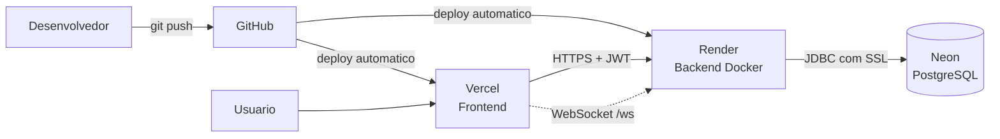

# Documentação de DevOps do Tarrafa

Esta pasta explica como o **Tarrafa — Sistema de Cardápio e Pedidos** é publicado e como funciona a infraestrutura dele. O projeto foi feito na disciplina de Engenharia de Software.

## Motivo

O sistema usa três serviços diferentes (Vercel, Render e Neon). Se ninguém escrever como eles se conectam, só quem configurou sabe como tudo funciona. Por isso criamos estes documentos, para que outra pessoa consiga:

- entender a arquitetura do deploy;
- configurar o ambiente local e o de produção;
- publicar uma nova versão e conferir se deu certo;
- descobrir o que fazer quando algo quebra.

Ao longo dos documentos usamos três marcações:

- **Implementado**: já existe no projeto.
- **Recomendação**: ideia de melhoria que ainda não existe.
- **Pendente de verificação**: não deu para confirmar pelos arquivos do projeto.

Nenhuma senha, token ou segredo real aparece aqui.

## Resumo da infraestrutura

| Parte | Tecnologia | Onde fica |
|---|---|---|
| Código | Git | GitHub |
| Frontend | React + Vite + TypeScript | Vercel (projeto `tarrafa-bistro`) |
| Backend | Java 21 + Spring Boot 3.3.5 + Maven | Render (Docker, plano Free) |
| Banco de dados | PostgreSQL 18 | Neon (plano Free, região São Paulo) |
| Login | JWT | dentro do backend |
| Tempo real | WebSocket com STOMP | dentro do backend (`/ws`) |

Endereços em produção:

- Frontend: https://tarrafa-bistro.vercel.app
- Backend: https://sistema-cardapio-e-pedidos-do-tarrafa.onrender.com



## Documentos

| Documento | Assunto |
|---|---|
| [Arquitetura de deploy](./arquitetura-de-deploy.md) | Serviços, comunicação entre eles e caminho de uma requisição |
| [Ambiente e variáveis](./ambiente-e-variaveis.md) | Variáveis de ambiente, local e produção |
| [Docker e backend](./docker-e-backend.md) | Dockerfile, Maven, Spring Boot e como rodar o backend |
| [Banco de dados](./banco-de-dados.md) | Neon, `schema.sql`, `seed.sql` e cuidados com os dados |
| [Pipeline de CI/CD](./pipeline-ci-cd.md) | GitHub, Vercel, Render, branches e gatilhos |
| [Deploy e rollback](./deploy-e-rollback.md) | Como publicar, conferir e voltar versão |
| [Testes pós-deploy](./testes-pos-deploy.md) | Checklist de testes depois de publicar |
| [Monitoramento e logs](./monitoramento-e-logs.md) | Onde ver logs e como achar problemas |
| [Segurança e contingência](./seguranca-e-contingencia.md) | Segredos, permissões, backup e recuperação |

Para entender o projeto, leia na ordem da tabela. Se alguma coisa quebrou, vá direto em [Monitoramento e logs](./monitoramento-e-logs.md).

## Pastas do repositório ligadas ao DevOps

```text
sistema-cardapio-pedidos/
├── .env.example          # modelo das variaveis do backend
├── .gitignore
├── database/
│   ├── schema.sql        # cria as tabelas
│   └── seed.sql          # cardapio inicial
├── backend/
│   ├── Dockerfile
│   ├── .dockerignore
│   ├── pom.xml
│   └── src/main/resources/application.properties
├── frontend/
│   ├── .env.example      # modelo do VITE_API_URL
│   ├── vercel.json
│   ├── vite.config.ts
│   └── package.json
└── docs/
    └── devops/           # esta documentacao
```

## Branches

| Branch | Uso |
|---|---|
| `atualiza-projeto` | Dispara os deploys na Vercel e no Render |
| `main` | Branch padrão do repositório no GitHub |
| `integracao/backend` | Integração do backend |
| `feature/backend-config` | Configuração do backend |
| `feature/frontend-hooks` | Hooks do frontend |
| `feature/frontend-services` | Serviços do frontend |
| `feature/frontend-types` | Tipos do frontend |

Só a `atualiza-projeto` está ligada a deploy automático. Mais detalhes em [Pipeline de CI/CD](./pipeline-ci-cd.md).

## O que existe e o que não existe

**Implementado**

- Deploy automático do frontend (Vercel) e do backend (Render) a cada commit na branch `atualiza-projeto`.
- Backend em Docker, com build em duas etapas.
- Health Check do Render em `/api/categorias`.
- Banco PostgreSQL no Neon, ligado por variáveis de ambiente.
- Login com JWT e conta de administrador criada a partir de variáveis de ambiente.
- Lista de origens do CORS configurável pela variável `CORS_ORIGENS`.
- Arquivos `.env` ignorados pelo Git (só o `.env.example` vai para o repositório).
- Testes unitários do backend, rodados na mão com `mvn test`.

**Não existe**

- GitHub Actions (não há a pasta `.github/workflows/`).
- Testes automáticos no deploy. O Dockerfile compila com `-DskipTests`.
- Backup ou snapshot configurado no Neon, nem proteção da branch `production` do banco.
- Monitoramento externo. Só olhamos os logs do Render e da Vercel.
- Pre-Deploy Command e Pull Request Previews no Render.

## Configuração confirmada nas plataformas

- **Render:** Docker, branch `atualiza-projeto`, diretório `sistema-cardapio-pedidos/backend`, deploy automático por commit, Health Check em `/api/categorias`. Variáveis cadastradas: `ADMIN_EMAIL`, `ADMIN_SENHA`, `CORS_ORIGENS`, `DB_PASSWORD`, `DB_URL`, `DB_USER` e `JWT_SECRET`. A `PORT` não foi cadastrada, o backend usa a que o Render entrega ou a `8080`. O `CORS_ORIGENS` tem as origens `http://localhost:*` e `https://tarrafa-bistro.vercel.app`, as mesmas do valor padrão do `application.properties`.
- **Vercel:** projeto `tarrafa-bistro`, branch `atualiza-projeto`, diretório `sistema-cardapio-pedidos/frontend`, variável `VITE_API_URL` em Production, Preview e Development. Duas opções ligadas: incluir arquivos fora do diretório raiz no Build Step e pular o deploy quando não há mudança no diretório raiz.
- **Neon:** plano Free, PostgreSQL 18, São Paulo, só a branch `production`, histórico de 6 horas, sem snapshots e sem proteção de branch.

## Pendente de verificação

- Como as outras branches (`feature/*` e `integracao/backend`) se juntam até chegar na `atualiza-projeto`.
- Comandos de build e framework configurados na Vercel (assumimos o padrão para Vite).
- Até onde o rollback pelo painel funciona nos planos gratuitos da Vercel e do Render.
- Fuso horário do contêiner no Render (afeta a virada do dia no fechamento). Ver [Docker e backend](./docker-e-backend.md).
- Execução do backend com Docker na máquina local (o comando está documentado, mas não foi testado).

## Observação

- Estes documentos só descrevem o projeto, não alteram o código.
- Os planos Free têm limites (serviço que dorme, histórico curto no banco). Isso aparece em [Deploy e rollback](./deploy-e-rollback.md) e em [Segurança e contingência](./seguranca-e-contingencia.md).
- Se mudar alguma configuração de infraestrutura, atualize o documento correspondente.
