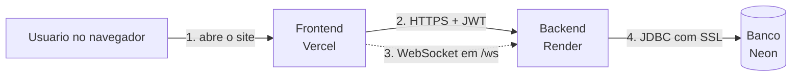
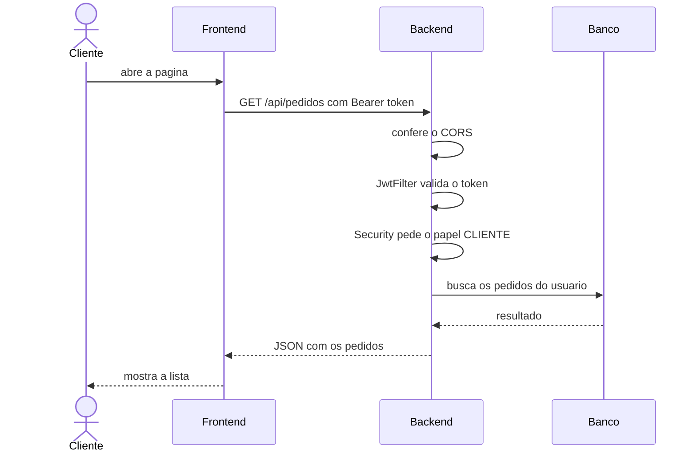

# Arquitetura de deploy

## Motivo

Este documento mostra onde cada parte do Tarrafa roda, como elas conversam e qual caminho uma requisição faz, do navegador até o banco de dados e de volta. Os outros documentos usam isso como base.

## Os três serviços

| Serviço | Plataforma | O que roda | Como é publicado |
|---|---|---|---|
| Frontend | Vercel (`tarrafa-bistro`) | React + Vite, entregue como arquivos estáticos | Deploy automático pela branch `atualiza-projeto` |
| Backend | Render (plano Free) | API Spring Boot dentro de um contêiner Docker | Deploy automático pela branch `atualiza-projeto` |
| Banco | Neon (plano Free, São Paulo) | PostgreSQL 18, branch `production` | Serviço gerenciado, não tem deploy |

- Frontend: https://tarrafa-bistro.vercel.app
- Backend: https://sistema-cardapio-e-pedidos-do-tarrafa.onrender.com



Pontos importantes:

- O frontend nunca fala direto com o banco. Só o backend tem os dados de acesso do Neon.
- O frontend é só HTML, CSS e JavaScript. As regras de negócio e as permissões ficam no backend.
- O backend não guarda sessão. Quem identifica o usuário é o token JWT enviado em cada requisição.

## Configuração

### Como o frontend acha o backend

O frontend lê a variável `VITE_API_URL`. Se ela não existir, usa `http://localhost:8080` (arquivo `frontend/src/services/api.ts`).

| Ambiente | Valor |
|---|---|
| Local | não precisa criar, usa `http://localhost:8080` |
| Produção | definida no painel da Vercel |

O Vite grava o valor da variável dentro dos arquivos gerados no momento do build. Então, se o endereço do backend mudar, é preciso fazer um novo deploy do frontend.

O endereço do WebSocket sai do mesmo valor: o frontend troca `http` por `ws` e põe `/ws` no fim (`frontend/src/services/tempoReal.ts`).

### CORS

O backend só aceita navegadores que venham de origens autorizadas. A lista vem da variável `CORS_ORIGENS`. Se ela não existir, vale o padrão do `application.properties`:

```text
http://localhost:*,https://tarrafa-bistro.vercel.app
```

A mesma lista é usada em dois lugares:

| Onde | Classe | Escopo |
|---|---|---|
| Requisições REST | `CorsConfig` | rotas `/api/**` |
| WebSocket | `WebSocketConfig` | endpoint `/ws` |

A variável `CORS_ORIGENS` está cadastrada no Render com as mesmas origens do padrão: `http://localhost:*` e `https://tarrafa-bistro.vercel.app`.

### Conexão com o banco

O backend monta a conexão com `DB_URL`, `DB_USER` e `DB_PASSWORD`. O pool de conexões (HikariCP) está assim:

| Propriedade | Valor | Para quê |
|---|---|---|
| `maximum-pool-size` | 5 | limita as conexões abertas |
| `connection-timeout` | 30000 ms | tempo máximo esperando uma conexão |
| `max-lifetime` | 240000 ms | renova a conexão antes de o Neon derrubar |

O backend não cria as tabelas (`ddl-auto=none`). Elas vêm dos scripts SQL, como explicado em [Banco de dados](./banco-de-dados.md).

## Funcionamento

### Permissões da API

Quem controla o acesso é o Spring Security (`SecurityConfig`):

| Rota | Quem acessa |
|---|---|
| `OPTIONS` em qualquer rota | todos |
| `/api/auth/**` (cadastro e login) | todos |
| `GET /api/categorias/**` e `GET /api/produtos/**` | todos |
| `/ws` e `/ws/**` | todos no handshake, a autenticação é feita depois no STOMP |
| `/api/admin/**` | só `ADMIN` |
| `/api/pedidos/**` | só `CLIENTE` |
| qualquer outra | usuário logado |

### Caminho de uma requisição

Exemplo: um cliente logado abre a tela "Meus pedidos".



Passo a passo:

1. O navegador carrega o frontend pela Vercel. O `vercel.json` manda qualquer rota para o `index.html`, porque o site é uma SPA.
2. O frontend chama a API usando `VITE_API_URL` e manda o token (guardado no `localStorage`) no cabeçalho `Authorization: Bearer ...`.
3. O backend confere se a origem está liberada no CORS.
4. O `JwtFilter` valida o token. Se for inválido ou vencido, a requisição segue sem autenticação e o Spring Security bloqueia.
5. O Spring Security aplica as regras da tabela acima.
6. Controller, service e repositório fazem o trabalho e consultam o PostgreSQL.
7. A resposta volta em JSON. Se vier `403`, o frontend dispara o evento `sessao-expirada` e desloga o usuário.

### Tempo real (WebSocket/STOMP)

Quando o administrador muda o status de um pedido, o cliente vê a mudança sem recarregar a página.

- O handshake em `/ws` é público, mas o comando `CONNECT` do STOMP exige o cabeçalho `Authorization: Bearer ...`. Sem token válido a conexão é recusada (`WebSocketAuthInterceptor`).
- O canal `/topic/admin/...` só aceita assinatura de quem é `ADMIN`.
- Cada cliente assina `/user/queue/pedidos` e recebe só os próprios pedidos.
- Se a conexão cair, o frontend tenta reconectar a cada 5 segundos.

## Como executar

Comandos para conferir cada parte em produção, usando `curl`.

Backend no ar e falando com o banco:

```bash
curl -i https://sistema-cardapio-e-pedidos-do-tarrafa.onrender.com/api/categorias
```

Esperado: `200` e uma lista de categorias em JSON. É a mesma rota do Health Check do Render.

CORS liberado para o frontend:

```bash
curl -i -X OPTIONS https://sistema-cardapio-e-pedidos-do-tarrafa.onrender.com/api/categorias \
  -H "Origin: https://tarrafa-bistro.vercel.app" \
  -H "Access-Control-Request-Method: GET"
```

Esperado: cabeçalho `Access-Control-Allow-Origin` com a origem enviada. Se não aparecer, a origem não está no `CORS_ORIGENS`.

Frontend no ar:

```bash
curl -I https://tarrafa-bistro.vercel.app
```

Rota de admin sem token:

```bash
curl -i https://sistema-cardapio-e-pedidos-do-tarrafa.onrender.com/api/admin/dashboard
```

Esperado: `403`. Se vier `200`, as permissões estão erradas.

O checklist completo está em [Testes pós-deploy](./testes-pos-deploy.md).

## Segurança

- Os segredos (`DB_URL`, `DB_USER`, `DB_PASSWORD`, `JWT_SECRET`, `ADMIN_EMAIL`, `ADMIN_SENHA`) ficam só nas variáveis de ambiente do Render. O frontend não recebe nenhum.
- Frontend e backend usam HTTPS. A conexão com o Neon usa SSL (`sslmode=require` no modelo do `DB_URL`).
- A API usa JWT no cabeçalho e não cookie de sessão, por isso o CSRF está desligado no `SecurityConfig`.
- O frontend guarda o JWT no `localStorage`. É simples, mas o token pode ser roubado se existir uma falha de XSS. Ver [Segurança e contingência](./seguranca-e-contingencia.md).

## Observação

- **Render Free:** o serviço pode dormir depois de um tempo sem acesso, e a primeira requisição depois disso fica lenta. Pendente de verificação: o tempo exato de inatividade no painel.
- **Neon Free:** o próprio `application.properties` comenta que o Neon pode suspender o banco quando fica parado. Por isso o pool tem `max-lifetime` curto.
- **WebSocket:** o backend usa o broker simples em memória do Spring (`enableSimpleBroker`). Funciona com uma instância só, que é o caso atual. Com várias instâncias, as mensagens não seriam compartilhadas.
- **Previews da Vercel:** cada Preview tem um endereço diferente, e ele só consegue chamar a API se estiver no `CORS_ORIGENS`. Como a lista só tem localhost e o endereço de produção, os Previews não conseguem chamar a API (o navegador bloqueia por CORS).

## Recomendações

Nada abaixo existe hoje.

| Ideia | Benefício |
|---|---|
| Criar um workflow do GitHub Actions com `mvn test` e `npm run build` | Pegar erros antes do deploy |
| Liberar os previews da Vercel no CORS com um padrão de origem | Testar branches sem editar o Render |
| Usar um monitor externo chamando `/api/categorias` | Saber quando o backend cai |
| Criar uma branch de testes no Neon | Testar scripts SQL sem risco |
| Desligar `spring.jpa.show-sql` em produção | Logs mais limpos |
