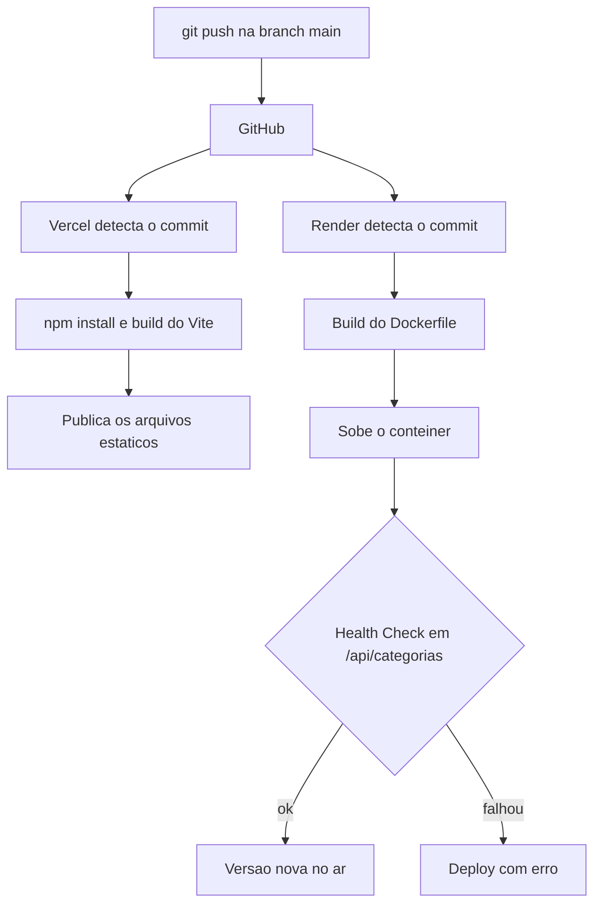

# Pipeline de CI/CD

## Motivo

Este documento explica como o código sai do GitHub e chega em produção. No Tarrafa o deploy é feito pela integração direta do GitHub com a Vercel e com o Render. **Não existe GitHub Actions** (a pasta `.github/workflows/` não existe) e não existe etapa automática de testes.

Então o que temos é entrega contínua simples (CD), sem integração contínua (CI) completa.

## Configuração

### Branches

| Branch | Uso |
|---|---|
| `main` | Branch padrão do repositório no GitHub. Dispara os deploys de produção |
| `DevOps` | Branch de trabalho da documentação. Entra na `main` por merge |

O trabalho é feito na `DevOps` e, quando está pronto, entra na `main` por merge.

### Vercel (frontend)

| Configuração | Valor |
|---|---|
| Projeto | `tarrafa-bistro` |
| Branch | `main` |
| Diretório raiz | `sistema-cardapio-pedidos/frontend` |
| Variável | `VITE_API_URL` (Production, Preview e Development) |
| Include files outside the root directory in the Build Step | ligado |
| Skip deployments when there are no changes to the root directory or its dependencies | ligado |

O `frontend/vercel.json` só tem uma regra: qualquer rota é reescrita para `/index.html`, para o React Router funcionar ao recarregar a página.

Pendente de verificação: o framework e os comandos de build configurados na Vercel. Pelo `package.json`, o script de build é `tsc -b && vite build`, e o padrão da Vercel para Vite é `npm run build` com saída na pasta `dist`.

Efeito das opções ligadas: um commit que mexe só no backend ou só na pasta `docs/` não gera deploy novo do frontend.

### Render (backend)

| Configuração | Valor |
|---|---|
| Tipo | Docker |
| Branch | `main` |
| Diretório raiz | `sistema-cardapio-pedidos/backend` |
| Deploy automático | por commit |
| Health Check | `/api/categorias` |
| Pre-Deploy Command | não tem |
| Pull Request Previews | desligado |
| Plano | Free |

## Funcionamento



Passo a passo:

1. O desenvolvedor faz `git push` na `main`.
2. O GitHub avisa a Vercel e o Render.
3. **Vercel:** instala as dependências, roda o build do Vite e publica os arquivos. Se o commit não mexeu no diretório do frontend, o deploy é pulado.
4. **Render:** monta a imagem com o `Dockerfile` (compila com Maven e `-DskipTests`), sobe o contêiner e consulta o Health Check.
5. Os dois deploys são independentes. Um pode dar certo e o outro falhar.

## Como executar

Publicar uma versão nova:

```bash
git checkout main
git pull
git add .
git commit -m "descricao da mudanca"
git push origin main
```

Conferir o resultado:

1. **Vercel:** abra o projeto `tarrafa-bistro`, aba Deployments. O deploy mais novo deve estar com status Ready. Se falhou, abra e leia o Build Logs.
2. **Render:** abra o serviço do backend, aba Events (ou Deploys). O deploy mais novo deve aparecer como live. Se falhou, leia os Logs.
3. Rode os testes do [checklist pós-deploy](./testes-pos-deploy.md).

## Segurança

- Os segredos ficam nos painéis da Vercel e do Render, nunca no repositório.
- Como o deploy é automático, **qualquer commit na `main` vai direto para produção**. Se o código não compilar, o deploy falha e a versão anterior continua no ar (ver [Deploy e rollback](./deploy-e-rollback.md)). Se compilar mas tiver erro de lógica, o erro vai para produção.
- Pendente de verificação: se a branch `main` tem proteção no GitHub (por exemplo, exigir pull request).

## Observação

- O que **não** existe: GitHub Actions, testes automáticos antes do deploy, etapa de lint no pipeline, Pre-Deploy Command no Render e previews de pull request no Render.
- Os testes unitários existem (`mvn test`), mas precisam ser rodados na mão antes do push.

**Recomendações**

| Ideia | Benefício |
|---|---|
| Criar `.github/workflows/ci.yml` rodando `mvn test` no backend e `npm run lint` e `npm run build` no frontend | Avisar erros antes de publicar |
| Trabalhar com pull request para a `main` | Revisão antes do deploy |
| Proteger a branch `main` no GitHub | Evitar push direto em produção |
