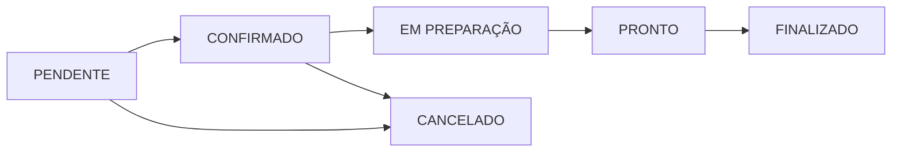

# 🍽️ Sistema de Cardápio e Pedidos

### Tarrafa Bistrô do Mar

> Sistema web para gerenciamento de cardápio e pedidos, desenvolvido como projeto acadêmico da disciplina de Engenharia de Software.

<p align="center">


</p>

---

## 📖 Sobre o projeto

O **Sistema de Cardápio e Pedidos** foi desenvolvido para centralizar o gerenciamento do cardápio e dos pedidos do restaurante **Tarrafa Bistrô do Mar**, especializado em pescado e com proposta de alto padrão.

O sistema permite que clientes consultem o cardápio, realizem pedidos e acompanhem seus status, enquanto o administrador gerencia produtos, categorias e pedidos. As informações são atualizadas em tempo real, permitindo que as alterações realizadas pelo administrador sejam refletidas para os clientes sem a necessidade de recarregar a página.

> O projeto não é apenas um site de cardápio. É um sistema de informação completo, com interface, backend, banco de dados, autenticação, regras de negócio e persistência de dados.

---

## ⚙️ Funcionalidades

Todas as funcionalidades previstas para o sistema foram implementadas e concluídas.

### Cliente

- [x] Cadastro
- [x] Login
- [x] Visualização do cardápio
- [x] Criação de pedidos
- [x] Alteração de quantidade
- [x] Remoção de itens
- [x] Adição de observações
- [x] Confirmação e cancelamento do pedido
- [x] Acompanhamento do pedido
- [x] Acompanhamento em tempo real

### Administrador

- [x] Login (conta fixa)
- [x] Gerenciamento de categorias
- [x] Cadastro de produtos
- [x] Edição de produtos
- [x] Remoção de produtos
- [x] Ativação e desativação de produtos
- [x] Visualização dos pedidos
- [x] Alteração do status dos pedidos
- [x] Encerramento do dia com dashboard de controle

---

## 🔄 Fluxo de status do pedido

O sistema possui um fluxo de status que representa as etapas de processamento dos pedidos, desde a solicitação do cliente até sua finalização.



---

## 📋 Regras de negócio

| Código | Regra |
| ------ | ----- |
| RN01 | Produto desativado não entra em novos pedidos, mas continua nos pedidos antigos. |
| RN02 | O item guarda o preço do momento da compra. |
| RN03 | Pedido confirmado não pode mais ser editado. |
| RN04 | Só são aceitas as transições de status válidas. |
| RN05 | O cadastro público sempre cria um cliente. |
| RN06 | O cliente só enxerga os próprios pedidos. |
| RN07 | Produto que já aparece em pedidos só pode ser desativado, não excluído. |

---

## 🛠️ Tecnologias

| Tecnologia | Utilização |
| ---------- | ---------- |
| Java 21 | Desenvolvimento do backend |
| Spring Boot | Framework para desenvolvimento do backend |
| Spring Security + JWT | Autenticação e controle de acesso |
| WebSocket (STOMP) | Comunicação e atualização em tempo real |
| React | Desenvolvimento da interface frontend |
| TypeScript | Tipagem e desenvolvimento frontend |
| PostgreSQL | Banco de dados relacional |
| Maven | Gerenciamento de dependências e build do backend |
| JUnit + Mockito | Testes unitários |
| Git | Controle de versão |
| GitHub | Hospedagem e colaboração no código |

---

## 🏗️ Arquitetura

O projeto utiliza uma arquitetura em camadas, na qual cada camada possui uma responsabilidade específica. Essa organização facilita a manutenção, a evolução e a separação das responsabilidades do sistema.

```text
Frontend
   │
   ▼
Controller    → Recebe as requisições e direciona as operações
   │
   ▼
Service       → Executa as regras de negócio
   │
   ▼
Repository    → Realiza o acesso e a comunicação com os dados
   │
   ▼
PostgreSQL    → Armazena as informações do sistema
```

---

## 📂 Estrutura do repositório

```text
sistema-cardapio-pedidos/
│
├── backend/
│   ├── src/main/java/com/tarrafa/
│   │   ├── controller/
│   │   ├── service/
│   │   ├── repository/
│   │   ├── entity/
│   │   ├── dto/
│   │   ├── security/
│   │   ├── exception/
│   │   └── config/
│   └── pom.xml
│
├── frontend/
│   ├── src/
│   │   ├── components/
│   │   ├── pages/
│   │   ├── services/
│   │   ├── hooks/
│   │   └── types/
│   └── package.json
│
├── database/
│   ├── schema.sql
│   └── seed.sql
│
├── docs/
│   ├── requisitos.md
│   ├── arquitetura.md
│   ├── api.md
│   └── diagramas/
│
├── .env.example
├── .gitignore
└── README.md
```

---

## 🚀 Como rodar o projeto

Guia completo para rodar o projeto localmente no **Windows**, partindo de um computador **sem nada instalado**.

### Visão geral

O projeto tem três partes que rodam ao mesmo tempo:

| Parte | Tecnologia | Porta |
| ----- | ---------- | ----- |
| Backend | Java 21 + Spring Boot (Maven) | 8080 |
| Frontend | React + TypeScript (Vite) | 5173 |
| Banco de dados | PostgreSQL | 5432 |

> ⚠️ O arquivo `.env.example` aponta para um banco na nuvem (Neon). **Não use esse banco.** Neste guia você cria um PostgreSQL **local**, e os scripts `schema.sql` e `seed.sql` já vêm no projeto.

### 1. Instalar os programas

Abra o **PowerShell** e rode os comandos abaixo, um por vez:

```powershell
winget install EclipseAdoptium.Temurin.21.JDK
winget install Apache.Maven
winget install OpenJS.NodeJS.LTS
winget install PostgreSQL.PostgreSQL.16
```

**Sobre o PostgreSQL:**

- Durante a instalação ele pede uma **senha para o usuário `postgres`**. Anote essa senha, você vai usar mais adiante.
- Deixe a porta padrão **5432**.

**Se o `winget` não funcionar**, baixe nos sites oficiais:

- JDK 21: https://adoptium.net
- Maven: https://maven.apache.org/download.cgi
- Node.js (versão LTS): https://nodejs.org
- PostgreSQL: https://www.postgresql.org/download/windows/

#### Conferir a instalação

**Feche e abra o PowerShell de novo**, depois rode:

```powershell
java -version     # precisa mostrar versão 21
mvn -version
node -v
npm -v
```

### 2. Baixar o projeto

Clone o repositório (ou extraia o `.zip`, se tiver baixado assim):

```powershell
git clone https://github.com/Luxxosz/sistema-cardapio-pedidos.git
cd sistema-cardapio-pedidos
```

A pasta que importa é a que contém `backend`, `frontend` e `database`. Nos próximos passos, ela é a **raiz do projeto**. Se você extraiu um `.zip`, ela pode estar dentro de pastas repetidas, por exemplo:

```text
sistema-cardapio-pedidos (2)\sistema-cardapio-pedidos\sistema-cardapio-pedidos\
```

Abra o PowerShell dentro dessa pasta (botão direito na pasta → *Abrir no Terminal*).

### 3. Criar o banco de dados local

Na raiz do projeto, rode (vai pedir a senha do `postgres` em cada comando):

```powershell
$env:PGCLIENTENCODING="UTF8"
& "C:\Program Files\PostgreSQL\16\bin\psql.exe" -U postgres -c "CREATE DATABASE tarrafa;"
& "C:\Program Files\PostgreSQL\16\bin\psql.exe" -U postgres -d tarrafa -f database\schema.sql
& "C:\Program Files\PostgreSQL\16\bin\psql.exe" -U postgres -d tarrafa -f database\seed.sql
```

- `schema.sql` cria as tabelas.
- `seed.sql` carrega o cardápio (17 categorias e 136 produtos).
- O `seed.sql` só funciona em banco **vazio**.

#### Alternativa com interface gráfica (pgAdmin)

O pgAdmin é instalado junto com o PostgreSQL:

1. Crie um banco chamado `tarrafa`.
2. Abra o **Query Tool** nesse banco.
3. Execute o conteúdo de `database/schema.sql` e depois o de `database/seed.sql`.

### 4. Criar o arquivo `.env`

Na **raiz do projeto**, copie o exemplo e edite:

```powershell
copy .env.example .env
notepad .env
```

Deixe o conteúdo assim (troque a senha do Postgres):

```properties
DB_URL=jdbc:postgresql://localhost:5432/tarrafa
DB_USER=postgres
DB_PASSWORD=SENHA_QUE_VOCE_ESCOLHEU_NO_POSTGRES

JWT_SECRET=uma_frase_bem_grande_com_mais_de_32_letras_aqui
ADMIN_EMAIL=admin@tarrafa.com
ADMIN_SENHA=admin123
```

- `JWT_SECRET` precisa ter **pelo menos 32 caracteres**.
- `ADMIN_EMAIL` e `ADMIN_SENHA` são o login do administrador. O backend cria essa conta sozinho na primeira vez que sobe.

### 5. Rodar o backend

Num terminal, a partir da raiz do projeto:

```powershell
cd backend
mvn spring-boot:run
```

- Na primeira vez demora, porque baixa as dependências.
- Está pronto quando aparecer `Started TarrafaApplication` e `Conta do administrador criada`.
- **Deixe esse terminal aberto.**

### 6. Rodar o frontend

Abra **outro terminal**, a partir da raiz do projeto:

```powershell
cd frontend
npm install
npm run dev
```

O terminal mostra o endereço, normalmente **http://localhost:5173**. Abra no navegador.

> Não precisa criar `.env` no frontend. O padrão já aponta para `http://localhost:8080`.

### 7. Testar

- **Cliente:** crie uma conta na tela de cadastro e faça um pedido.
- **Administrador:** faça login com o `ADMIN_EMAIL` e `ADMIN_SENHA` definidos no `.env`.

### Resumo rápido (depois de tudo instalado)

```powershell
# Terminal 1 — backend
cd backend
mvn spring-boot:run

# Terminal 2 — frontend
cd frontend
npm run dev
```

Depois é só abrir **http://localhost:5173**.

### Problemas comuns

| Erro | Solução |
| ---- | ------- |
| `java`, `mvn` ou `node` não reconhecido | Feche e abra o terminal de novo; confirme que o JDK é o 21 |
| `password authentication failed` | O `DB_PASSWORD` do `.env` está diferente da senha do Postgres |
| `Connection refused` na porta 5432 | Serviço do PostgreSQL parado: abra "Serviços" do Windows e inicie o `postgresql-x64-16` |
| `psql` não reconhecido | Use o caminho completo como nos comandos acima, ou use o pgAdmin |
| `Port 8080 already in use` | Feche o programa que está usando a porta 8080 |
| Frontend abre mas o cardápio não carrega | O backend não está rodando ou deu erro; confira o terminal dele |
| Acentos quebrados no cardápio | Apague e recrie o banco, e rode `schema.sql` e `seed.sql` com `$env:PGCLIENTENCODING="UTF8"` |
| `CREATE DATABASE` diz que o banco já existe | Tudo certo, pule esse comando e rode os outros dois |

---

## 🎨 Identidade visual

A identidade visual do sistema foi baseada no material de referência do restaurante, utilizando uma paleta de cores que transmite sofisticação e remete ao ambiente marítimo.

| Cor | Código |
| --- | ------ |
| 🟢 Verde Maré | `#0E2620` |
| 🟩 Verde Oliveira | `#173A30` |
| 🟨 Latão | `#B8934F` |
| 🍷 Vinho Safra | `#6B2434` |
| 📜 Linho | `#EDE8D6` |

---

## 👥 Equipe

| Nome | GitHub |
| ---- | ------ |
| **Luiz Eduardo** | [@Luxxosz](https://github.com/Luxxosz) |
| **Nícolas Ferreira** | [@Nicolas-Dev256](https://github.com/Nicolas-Dev256) |
| **Agnelo Christian** | [@AnriXD](https://github.com/AnriXD) |
| **Caua Evangelista** | [@CauaEvangelista](https://github.com/CauaEvangelista) |
| **Nicolas Caparroz** | [@nicolassousacaparroz-oss](https://github.com/nicolassousacaparroz-oss) |

---

<p align="center">
  <i>Tarrafa Bistrô do Mar. Da rede ao prato, na mesma maré.</i> 🌊
</p>
