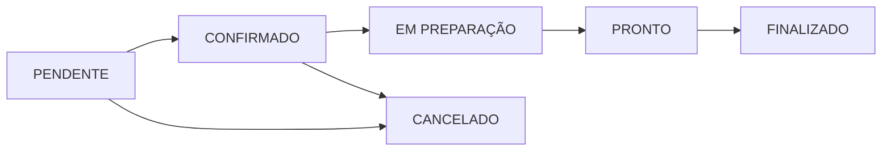

# 🍽️ Sistema de Cardápio e Pedidos

### Tarrafa Bistrô do Mar

> Sistema web para gerenciamento de cardápio e pedidos, desenvolvido como projeto acadêmico da disciplina de Engenharia de Software.

<p align="center">


</p>

---

## 📖 Sobre o projeto

O **Sistema de Cardápio e Pedidos** foi desenvolvido para centralizar o gerenciamento do cardápio e dos pedidos do restaurante **Tarrafa Bistrô do Mar**, especializado em pescado e de proposta alto padrão.

O sistema permite que clientes consultem o cardápio, realizem pedidos e acompanhem seu status, enquanto o administrador gerencia produtos, categorias e pedidos. Tudo é atualizado em tempo real: o que o administrador altera aparece para o cliente sem recarregar a página.

>  O projeto não é apenas um "site de cardápio". É um sistema de informação completo, com interface, backend, banco de dados, autenticação, regras de negócio e persistência dos dados.

---

##  Funcionalidades

###  Cliente

- [x] Cadastro
- [x] Login
- [x] Visualização do cardápio
- [x] Criação de pedidos
- [x] Alteração de quantidade
- [x] Remoção de itens
- [x] Adição de observações
- [x] Confirmação e cancelamento do pedido
- [x] Acompanhamento do pedido
- [ ] Acompanhamento em tempo real

###  Administrador

- [x] Login (conta fixa)
- [x] Gerenciamento de categorias
- [x] Cadastro de produtos
- [x] Edição de produtos
- [x] Remoção de produtos
- [x] Ativação/desativação de produtos
- [x] Visualização dos pedidos
- [x] Alteração do status dos pedidos
- [ ] Encerrar dia com dashboard de controle

---

##  Fluxo de status do pedido



---

##  Regras de negócio

| Código | Regra |
| ------ | ----- |
| RN01 | Produto desativado não entra em novos pedidos, mas continua nos pedidos antigos |
| RN02 | O item guarda o preço do momento da compra |
| RN03 | Pedido confirmado não pode mais ser editado |
| RN04 | Só são aceitas as transições de status válidas |
| RN05 | O cadastro público sempre cria um cliente |
| RN06 | O cliente só enxerga os próprios pedidos |
| RN07 | Produto que já aparece em pedidos só pode ser desativado, não excluído |

---

##  Tecnologias

| Tecnologia | Utilização |
| ---------- | ---------- |
|  Java 21 | Backend |
|  Spring Boot | Framework backend |
|  Spring Security + JWT | Autenticação e controle de acesso |
|  WebSocket (STOMP) | Atualização em tempo real |
|  React | Frontend |
|  TypeScript | Desenvolvimento frontend |
|  PostgreSQL | Banco de dados |
|  Maven | Gerenciamento do backend |
|  JUnit + Mockito | Testes unitários |
|  Git | Controle de versão |
|  GitHub | Hospedagem do projeto |

---

##  Arquitetura

O projeto utiliza uma arquitetura em camadas. Cada camada tem uma responsabilidade e só conversa com a vizinha:

```text
Frontend
   │
   ▼
Controller    → recebe as requisições e valida o formato
   │
   ▼
Service       → regras de negócio
   │
   ▼
Repository    → acesso aos dados
   │
   ▼
PostgreSQL
```
---

## 📂 Estrutura do repositório

```text
sistema-cardapio-pedidos/
│
├── backend/
│   ├── src/main/java/com/tarrafa/
│   │   ├── controller/
│   │   ├── service/
│   │   ├── repository/
│   │   ├── entity/
│   │   ├── dto/
│   │   ├── security/
│   │   ├── exception/
│   │   └── config/
│   └── pom.xml
│
├── frontend/
│   ├── src/
│   │   ├── components/
│   │   ├── pages/
│   │   ├── services/
│   │   ├── hooks/
│   │   └── types/
│   └── package.json
│
├── database/
│   ├── schema.sql
│   └── seed.sql
│
├── docs/
│   ├── requisitos.md
│   ├── arquitetura.md
│   ├── api.md
│   └── diagramas/
│
├── docker-compose.yml
├── .env.example
├── .gitignore
└── README.md
```
---

##  Identidade visual

Baseada no material do restaurante:

| Cor | Código |
| --- | ------ |
| 🟢 Verde Maré | `#0E2620` |
| 🟩 Verde Oliveira | `#173A30` |
| 🟨 Latão | `#B8934F` |
| 🍷 Vinho Safra | `#6B2434` |
| 📜 Linho | `#EDE8D6` |

---

## 👥 Equipe

| Nome | GitHub |
| ---- | ------ |
| _Luiz Eduardo_ | [@Luxxosz](https://github.com/Luxxosz) |
| _Nícolas Ferreira_ | [@Nicolas-Dev256](https://github.com/Nicolas-Dev256). |

---

<p align="center">
  <i>Tarrafa Bistrô do Mar. Da rede ao prato, na mesma maré.</i> 🌊
</p>

