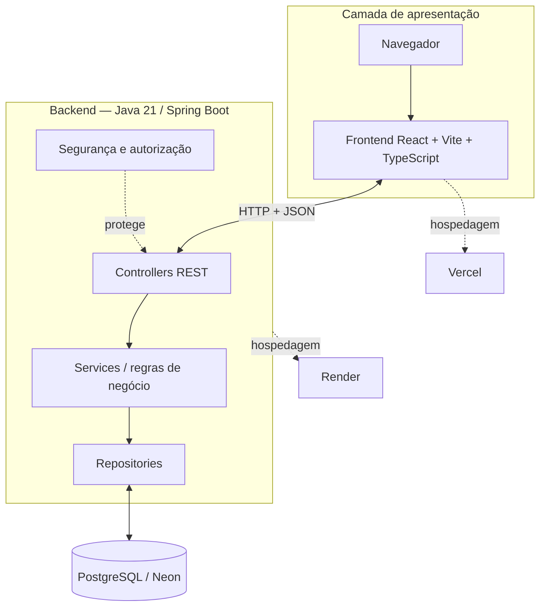

# Diagrama de Arquitetura

## Responsabilidades

- **Frontend:** interface e comunicação HTTP.
- **Controllers:** entrada e saída da API.
- **Services:** regras de negócio.
- **Repositories:** persistência.
- **Security:** autenticação e autorização, conforme implementadas.
- **PostgreSQL:** armazenamento persistente.

O diagrama é lógico. Detalhes como rede, CORS, build, health checks, containers e variáveis de ambiente devem ser documentados conforme os arquivos reais de deploy.