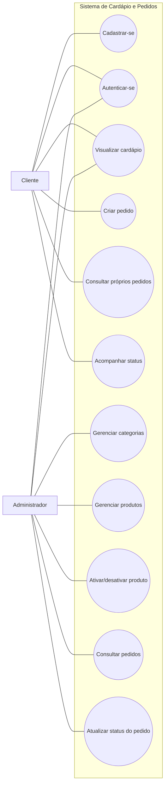

# Diagrama de Casos de Uso

O diagrama apresenta os casos de uso descritos no escopo acadêmico. Ele representa o comportamento esperado do sistema e deve ser revisado caso o escopo implementado seja diferente.

## Atores e responsabilidades

- **Cliente:** cadastro/autenticação, consulta do cardápio, criação e acompanhamento dos próprios pedidos.
- **Administrador:** autenticação, gerenciamento do cardápio, consulta de pedidos e atualização de status.

## Observações

- A autenticação é uma pré-condição para operações protegidas.
- O controle de permissões deve ser aplicado no backend.
- O diagrama não afirma que todas as operações já estão implementadas; compare-o com o código atual e os requisitos.