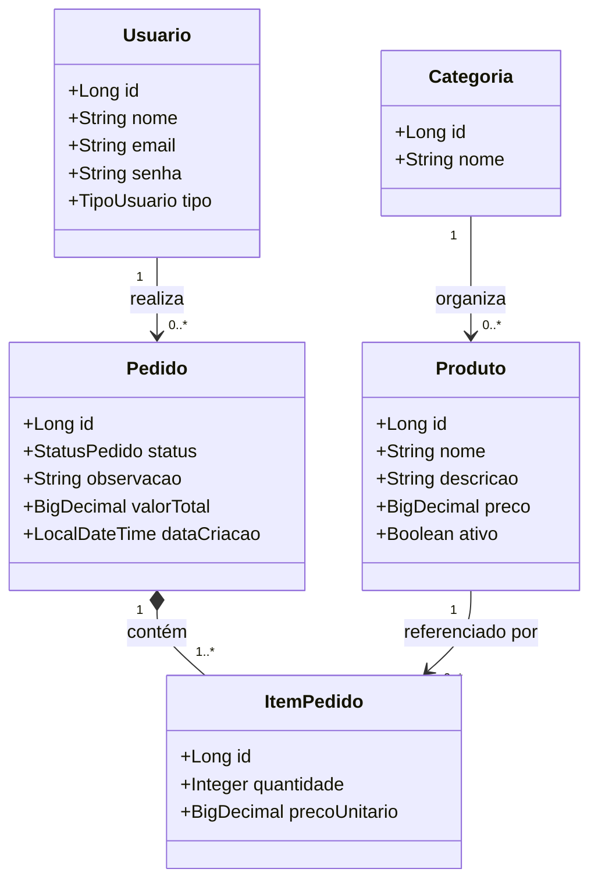

# Diagrama de Classes / Modelo de Domínio

O modelo abaixo deriva do modelo conceitual apresentado no material do projeto. Ajuste nomes, atributos, tipos, cardinalidades e enums de acordo com as entidades JPA e o esquema SQL reais.

## Regras de modelagem relevantes

- `ItemPedido` liga um pedido a um produto e registra quantidade e preço unitário histórico.
- `valorTotal` deve refletir o cálculo dos itens conforme a regra implementada.
- O atributo `senha` representa uma credencial armazenada de forma segura (hash), nunca a senha em texto puro.
- `TipoUsuario` e `StatusPedido` são nomes conceituais; confirme os enums e valores efetivamente usados no código.
