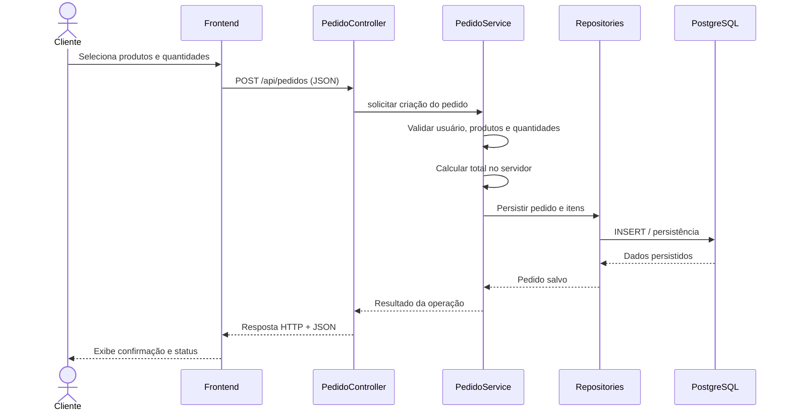

# Diagrama de Sequência — Criação de Pedido

Fluxo conceitual baseado no processo descrito no material do projeto. Confirme o nome dos Controllers, Services, DTOs e métodos com a implementação real.

## Regras importantes do fluxo

1. O usuário deve ser identificado a partir do mecanismo de autenticação do backend.
2. Produtos inexistentes ou indisponíveis e quantidades inválidas devem ser recusados.
3. O total é calculado pelo servidor a partir dos itens válidos.
4. Pedido e itens devem ser persistidos de forma consistente.
5. O status inicial previsto no material é `PENDENTE`.
