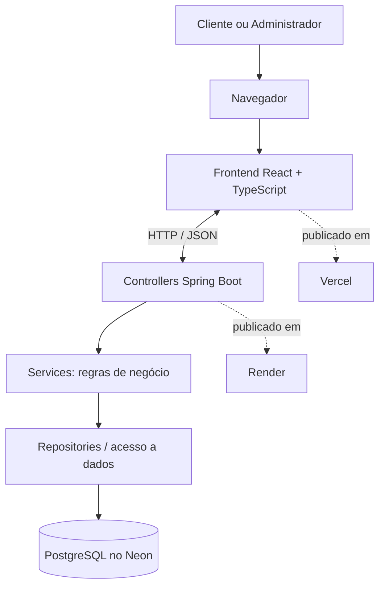

Arquitetura do Sistema

**Projeto:** Sistema de Cardápio e Pedidos — Tarrafa Bistrô do Mar  
**Tipo:** aplicação web cliente-servidor  
**Status deste documento:** arquitetura de referência baseada no material do projeto; detalhes internos devem ser conferidos no código atual.

## 1. Objetivo

O sistema centraliza a consulta do cardápio, a realização e o acompanhamento de pedidos e as operações administrativas de gerenciamento de categorias, produtos e status dos pedidos.

## 2. Tecnologias

| Camada | Tecnologia | Responsabilidade |
|---|---|---|
| Frontend | React + Vite + TypeScript | Interface web, navegação, formulários e comunicação HTTP com a API |
| Backend | Java 21 + Spring Boot + Maven | API, validações, regras de negócio, autenticação e coordenação das operações |
| Persistência | PostgreSQL | Armazenamento de usuários, categorias, produtos, pedidos e itens |
| Hospedagem do frontend | Vercel | Publicação da interface web |
| Hospedagem da API | Render | Execução da aplicação Spring Boot |
| Banco hospedado | Neon PostgreSQL | Serviço PostgreSQL utilizado pelo ambiente publicado |
| Versionamento | Git + GitHub | Histórico, branches, revisão e integração de mudanças |

URLs informadas para o ambiente publicado:
- Frontend: https://tarrafa-bistro.vercel.app
- API: https://sistema-cardapio-e-pedidos-do-tarrafa.onrender.com

> As URLs acima identificam os ambientes informados para o projeto. Endpoints específicos, variáveis e configurações devem ser confirmados no código e nos painéis de deploy. Não registre senhas, tokens ou valores secretos neste documento.

## 3. Visão arquitetural

O sistema utiliza uma arquitetura web em camadas. O frontend envia requisições HTTP para a API; o backend valida as entradas, aplica as regras de negócio e acessa o PostgreSQL por meio da camada de persistência.

O diagrama representa a arquitetura lógica e o fluxo esperado, não todos os detalhes de infraestrutura ou configuração.

## 4. Componentes e responsabilidades

### 4.1 Frontend

- Exibir o cardápio e os detalhes dos produtos.
- Permitir que o cliente monte e acompanhe pedidos.
- Disponibilizar as telas administrativas conforme o perfil autenticado.
- Enviar requisições à API e apresentar respostas, validações e erros.
- Manter a URL da API em configuração de ambiente, evitando depender de `localhost` no ambiente publicado.

### 4.2 Backend

A aplicação Spring Boot expõe a API e concentra as regras de negócio.

- **Controller:** recebe requisições HTTP, valida o formato da entrada e retorna respostas.
- **Service:** aplica as regras de negócio, como cálculo do total e validação de transições de status.
- **Repository:** abstrai consultas e persistência.
- **Entity:** representa os conceitos persistidos.
- **DTO:** define os dados recebidos e devolvidos pela API.
- **Security:** concentra os mecanismos de autenticação e autorização implementados.
- **Config:** configurações transversais da aplicação.
- **Exception:** tratamento padronizado de erros, conforme a implementação existente.

Os nomes acima representam a organização prevista para o projeto. A estrutura exata deve seguir os pacotes que já existem no repositório.

### 4.3 Banco de dados

O modelo conceitual descrito no trabalho contém:

- **Usuario:** dados de identificação, e-mail, credencial armazenada de forma segura e tipo/perfil.
- **Categoria:** agrupamento de produtos.
- **Produto:** nome, descrição, preço, disponibilidade e categoria.
- **Pedido:** usuário responsável, status, observação, total e data de criação.
- **ItemPedido:** produto, quantidade e preço unitário registrado no momento do pedido.

Relacionamentos conceituais:
- Categoria 1:N Produto.
- Usuario 1:N Pedido.
- Pedido 1:N ItemPedido.
- Produto 1:N ItemPedido.

O esquema efetivamente implantado deve ser confirmado em `database/schema.sql` e/ou nas entidades JPA.

## 5. Fluxos de comunicação

### Consulta ao cardápio
1. O usuário abre a interface no navegador.
2. O frontend solicita os produtos e categorias disponíveis à API.
3. O backend consulta os dados persistidos.
4. A API devolve os dados em JSON e o frontend renderiza o cardápio.

### Criação de pedido
1. O cliente seleciona produtos e quantidades.
2. O frontend envia os dados do pedido à API.
3. O backend identifica o usuário autenticado, valida produtos e quantidades e calcula o total.
4. O backend persiste o pedido e seus itens.
5. A API devolve a representação do pedido criado.
6. O cliente acompanha o status pela interface.

### Operação administrativa
1. O administrador autentica-se.
2. A API valida a identidade e as permissões.
3. O administrador gerencia produtos/categorias e atualiza status de pedidos.
4. O backend valida a operação e persiste a mudança.

## 6. Segurança e configuração

- Credenciais e chaves devem ser fornecidas por variáveis de ambiente.
- Arquivos `.env` reais não devem ser versionados.
- O `.env.example` deve conter apenas nomes de variáveis e valores ilustrativos.
- Senhas de usuários não devem ser armazenadas em texto puro.
- Operações administrativas devem ser protegidas por autorização no backend, e não apenas por ocultação de telas.
- A configuração de CORS deve permitir apenas as origens necessárias aos ambientes utilizados.
- Erros não devem revelar credenciais, tokens ou detalhes internos desnecessários.

Os mecanismos exatos (por exemplo, formato de token e regras de expiração) devem ser descritos após a conferência das classes de segurança existentes.

## 7. Build, execução e deploy

- O backend é construído com Maven e Java 21.
- O frontend usa Node.js/npm, conforme o `package.json` e o lockfile presentes no repositório.
- O frontend é publicado na Vercel e a API no Render, segundo as informações do projeto.
- O banco utilizado no ambiente publicado é PostgreSQL hospedado no Neon.
- Mudanças de configuração devem ser testadas em ambiente local antes do deploy.

Os comandos exatos de execução devem ser copiados dos scripts e arquivos reais do repositório para evitar divergências.

## 8. Decisões e pontos a confirmar

1. Conferir os pacotes e classes reais do backend.
2. Conferir as rotas reais nos Controllers antes de atualizar `api.md`.
3. Conferir o esquema real do banco e as migrations/scripts.
4. Confirmar quais endpoints exigem autenticação e quais perfis podem acessá-los.
5. Confirmar a configuração atual de CORS, variáveis de ambiente e deploy.
6. Atualizar este documento sempre que a arquitetura mudar.
